  

<h3 align="center">
  Building futuristic digital experiences with code ⚡
</h3>

  

---

## 💫 About Me

  🎓 B.Tech Student at Newton School of Technology, RU 
  💻 Full Stack Developer & Competitive Programmer 
  🚀 Passionate about futuristic UI/UX and web development 
  🌱 Currently exploring Backend Development and AI Integration 
  ✨ Open Source Contributor at GSSoC 2026 
  ⚡ Building real-world projects and learning by shipping

---

## 🌐 Connect With Me

  
  
  
  

---

## 🛠️ Tech Stack

### Frontend

  

### Backend & Database

  

### Tools & Workflow

  

---

  

---

## 🌟 Open Source Contributions

  
  

- Fixed dark mode styling issues in **Nyay Setu Working**.
- Improved Back-to-Top button transitions and scroll logic in **The-Lighthouse**.
- Contributing to open-source projects through GSSoC.

  

---

## 📊 GitHub Statistics

  

  

---

## 📈 Contribution Activity

  

---

## 🐍 Contribution Snake

  <picture>
    <source
      media="(prefers-color-scheme: dark)"
      srcset="https://raw.githubusercontent.com/AdityaSrivastava-07/AdityaSrivastava-07/output/github-contribution-grid-snake-dark.svg">
    <source
      media="(prefers-color-scheme: light)"
      srcset="https://raw.githubusercontent.com/AdityaSrivastava-07/AdityaSrivastava-07/output/github-contribution-grid-snake.svg">
    
  </picture>

---

## 🎮 GitHub Breakout

  <picture>
    <source
      media="(prefers-color-scheme: dark)"
      srcset="https://raw.githubusercontent.com/AdityaSrivastava-07/AdityaSrivastava-07/github-breakout/images/breakout-dark.svg">
    <source
      media="(prefers-color-scheme: light)"
      srcset="https://raw.githubusercontent.com/AdityaSrivastava-07/AdityaSrivastava-07/github-breakout/images/breakout-light.svg">
    
  </picture>

---

## 💡 Currently Learning

  
  
  
  

---

## ✍️ Random Dev Quote

  

---

  

<h3 align="center">
  ⚡ Code. Create. Contribute. Repeat. ⚡
</h3>

  ⭐ Feel free to explore my repositories and connect with me!

